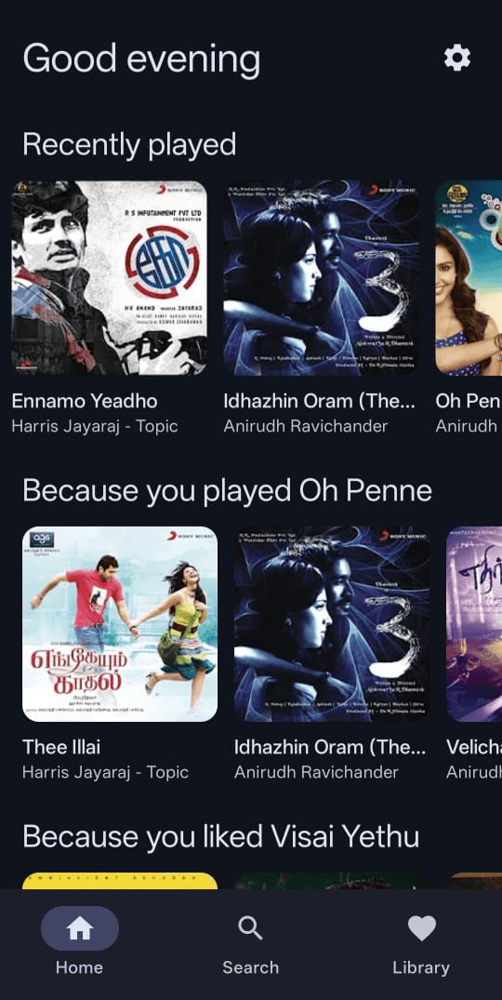

<!--
  Before publishing, search this file for "<aghielaan22>" and "<Aghielaan Saravanan>" and replace them.
  Optional: add an app icon at docs/icon.png and screenshots in docs/screenshots/,
  then uncomment the two marked blocks below.
-->

<h1 align="center">LAbel</h1>

<!-- <p align="center"></p> -->

<p align="center">
  <b>A clean, ad-free YouTube Music client for Android, wrapped in liquid glass.</b><br>
  Search anything, play it in the background, follow the lyrics, shape the sound, and keep your library to yourself.
</p>

<p align="center">
  
  
  
  
  
  
</p>

<p align="center">
  <a href="#-features">Features</a> ·
  <a href="#-install">Install</a> ·
  <a href="#-build-from-source">Build</a> ·
  <a href="#-privacy">Privacy</a> ·
  <a href="#-known-limitations">Limitations</a> ·
  <a href="#-roadmap">Roadmap</a> ·
  <a href="#-faq">FAQ</a>
</p>

---

## 📸 Screenshots

| Home | Search | Now Playing | Lyrics |
|:---:|:---:|:---:|:---:|
|  |  |  |  |

## ✨ Features

### 🔎 Search that makes sense
- Results sorted the way you'd expect: **Top result**, **Songs**, **Artists**, **Albums** and **Videos**, with filter chips
- **Recent searches** you can tap to repeat, remove one by one, or clear
- **Artist and album pages** with top songs, albums and full tracklists
- Tap and hold any song for quick actions: play next, add to queue, add to a playlist, like, share, go to artist
- **Swipe a song** right to add it to the queue, or left to play it next

### 🎧 Playback
- Background playback with **notification and lock-screen controls**
- A full **queue**: play next, add to queue, jump to any song, **drag to reorder**, swipe to remove
- **Shuffle** and **repeat** (off, all, one)
- **Autoplay**: when the queue runs out, LAbel keeps going with songs similar to the last one
- **Sleep timer** that fades out gently, with an "end of song" option
- **Fade between songs** (2, 4 or 6 seconds)
- Choose your **streaming quality**: High, Standard or Data saver

### 🎚️ Sound
- **Equalizer** with five bands and presets (Flat, Bass boost, Treble boost, Vocal, Rock, Pop, Electronic, Acoustic)
- **Loudness boost** of up to +12 dB for quiet songs
- **Skip silence**

### 🎨 A player worth looking at
- High-resolution album artwork
- **Colors that follow the cover**: the backdrop and accents change with every song
- **Synced lyrics** that scroll along with the music (tap a line to jump to it)
- **Gestures**: swipe the cover for next and previous, double-tap it to like, drag the player down to close it

### 💎 Liquid glass and themes
- Frosted-glass panels, a floating dock and a softly moving glow, with a **transparency slider** and an on/off switch
- **Eight color themes**: Dynamic (follows your wallpaper), Violet, Ocean, Emerald, Sunset, Rose, Gold and Mono, plus a pure-black **AMOLED**
- Light, dark or system brightness
- Smooth motion throughout: pull down to refresh, bouncy presses, animated transitions

### 📚 Your library
- **Liked songs**
- **Playlists**: create, rename, delete, add and remove songs, **drag to reorder**
- **Import playlists** from a YouTube or YouTube Music link, or from a CSV or text list (such as a Spotify export)
- **Recently played** on the Home screen
- **Backup and restore** to a file you control, so reinstalling never costs you your library

### 🧠 Made for you
- **Your stats**: listening time, top artists and top songs
- Home shelves that learn from what you finish and skip, such as **Made for you** and **More from** your favorite artists
- **ListenBrainz scrobbling**: send your listens to your free ListenBrainz profile (optional)

### 🛠️ The details
- **In-app update checker** that tells you when a new version is on GitHub
- Friendly messages and an offline banner when the connection drops
- Crash reports stay on your device, and you decide whether to share them

---

## 📲 Install

1. Go to the [**Releases**](https://github.com/aghielaan22/LAbel/releases) page and download the latest `LAbel-*.apk`.
2. Open the file on your phone. Android will ask you to allow installs from that source (your browser or file manager). Allow it.
3. If **Google Play Protect** warns about an "unrecognized app", that's normal for any app installed outside the Play Store. Choose **Install anyway**.
4. Open LAbel and search for something.

**Requirements:** Android 8.0 (API 26) or newer, and an internet connection. The glass blur needs Android 12 or newer. On older phones the glass is translucent but not blurred.

**Updating:** LAbel checks for new versions for you (you can turn this off in **Settings → Updates**). Install the new APK over the old one and your library and settings stay. If you're coming from a test or debug build, tap **Settings → Backup → Export library** first, uninstall the old app, install the new one, then use **Restore from backup**.

> ⚠️ LAbel isn't on Google Play. See the [disclaimer](#️-disclaimer) for why.

---

## 🏗️ Build from source

**You'll need:** the latest stable [Android Studio](https://developer.android.com/studio) and an Android device (a real phone is best) or an emulator. No API keys or accounts are required.

```bash
git clone https://github.com/aghielaan22/LAbel.git
```

1. Open the `LAbel` folder in Android Studio and let Gradle sync.
2. In `UpdateChecker.kt`, set `OWNER` to your own GitHub username if you fork the project, so the update checker looks at your releases.
3. Select your device and press **Run**.

**Making a release build:** use **Build → Generate Signed App Bundle / APK** and create your own signing key. Keep that key somewhere safe and never commit it. The repository doesn't contain one.

<details>
<summary><b>How the app is organized</b></summary>

<br>

| Area | What it does |
|---|---|
| `PlaybackService` | Owns the ExoPlayer and media session, resolves audio streams just in time, and applies skip silence, the sleep timer and the fades |
| `PlayerController` | The bridge between the screens and the player: queue, shuffle, repeat, autoplay, current song |
| `SoundEngine` | The equalizer and loudness boost, tied to the player's audio |
| `MusicRepository` | Searches YouTube Music and loads albums, artists, mixes, playlists and audio streams through NewPipeExtractor |
| `LyricsRepository` | Fetches and parses synced lyrics from LRCLIB |
| `ListenTracker`, `StatsRepository`, `ListenBrainz` | Decide what counts as a listen, keep your stats, and optionally scrobble |
| `LibraryRepository`, `PlaylistRepository`, `HistoryRepository`, `SearchHistoryRepository` | Store your data as small JSON files on the device |
| `BackupManager`, `PlaylistImporter` | Export and safely merge backups, and import playlists |
| `UpdateChecker` | Looks for new releases on GitHub |
| `Glass`, `AppTheme`, `Effects` | The liquid glass toolkit, the color themes and the reusable motion |
| `Navigator` | A simple stack for album, artist, stats, import, sound and settings pages |
| `CrashReporter` | Saves a crash report locally for the next launch |

The UI is built entirely with Jetpack Compose and Material 3.

</details>

---

## 🔒 Privacy

LAbel itself has **no ads, no accounts and no analytics**. Your liked songs, playlists, history and stats are stored only on your device.

To work, the app talks to a few services:

| Service | Why | What it receives |
|---|---|---|
| **YouTube** | Search and audio streams | Your search text, and requests for the songs you play |
| **LRCLIB** | Synced lyrics | The title and artist of the song you open lyrics for |
| **Google / YouTube image servers** | Album artwork and artist pictures | Requests for images |
| **GitHub** | Update checks | A request for your repository's releases, at most twice a day. You can turn it off |
| **ListenBrainz** | Scrobbling (only if you connect an account) | The title, artist and time of what you listen to, and what's playing now |

Those services see the usual technical information a website would, such as your IP address. Your ListenBrainz token is stored on your phone in LAbel's private storage. Crash reports are written to a file on your phone, and nothing is sent anywhere unless you tap **Share report**.

---

## ⚠️ Known limitations

- **Unofficial access.** LAbel gets its data through an open-source library, not an official API. When YouTube changes something, search or playback can stop working until the library is updated.
- **Fade, not crossfade.** Songs fade out and the next one fades in. They don't overlap.
- **Lyrics depend on a community database.** Popular songs are well covered, and obscure ones often aren't. Lyrics sync line by line, not word by word.
- **Artist pages are assembled from search results**, so an artist with an unusual name spelling may look sparse.
- **The equalizer and loudness boost depend on your phone.** Some phones and emulators don't support them, and the app says so.
- **Playlist import is only as good as the search.** Obscure tracks, live versions and remixes can fail to match.
- **With shuffle on**, the queue list shows the original order, not the random play order.
- **No offline downloads yet.**
- Videos play **audio only**.

---

## 🗺️ Roadmap

- [x] Search, playback, queue, shuffle and repeat
- [x] Library, playlists and listening history
- [x] Synced lyrics and artwork-based colors
- [x] Artist and album pages
- [x] Sleep timer and fades
- [x] Settings, backup and restore, crash reporting
- [x] Liquid glass, color themes and gestures
- [x] Equalizer, loudness boost and skip silence
- [x] Stats, personalized shelves and ListenBrainz scrobbling
- [x] Playlist import and drag to reorder
- [x] In-app update checker
- [ ] Lists that scroll underneath the glass dock
- [ ] A home screen widget
- [ ] Word-by-word synced lyrics
- [ ] True overlapping crossfade
- [ ] Android Auto
- [ ] Offline downloads (still being considered)

---

## ❓ FAQ

<details>
<summary><b>Is it free? Do I need an account?</b></summary>
<br>
Yes, it's free, and no, you don't need an account. LAbel doesn't have sign-in at all. A ListenBrainz account is optional, only if you want to keep a record of your listening.
</details>

<details>
<summary><b>Are there ads?</b></summary>
<br>
No. LAbel plays audio streams directly, and it doesn't contain any ads.
</details>

<details>
<summary><b>Will it keep working?</b></summary>
<br>
Probably, with updates. Because it relies on unofficial access to YouTube, it can break when YouTube changes its systems. When that happens, the fix is usually to update the extraction library and publish a new version, and the update checker will let you know.
</details>

<details>
<summary><b>Where is my data?</b></summary>
<br>
In your phone's private app storage. Use <b>Settings → Backup → Export library</b> to save a copy of your liked songs, playlists and settings to a file you control. Stats and your ListenBrainz token aren't part of the backup yet.
</details>

<details>
<summary><b>Why ListenBrainz and not Last.fm?</b></summary>
<br>
Last.fm announced that from December 1, 2026 its API keys require a paid Pro subscription from the key owner, which doesn't suit a free, open-source app. ListenBrainz is free and open, and needs no key, only your own user token.
</details>

<details>
<summary><b>Why isn't it on the Play Store?</b></summary>
<br>
Streaming YouTube audio this way is outside YouTube's Terms of Service, so a store listing isn't realistic. LAbel is distributed as an APK, and its source code is open.
</details>

<details>
<summary><b>I found a bug. What should I do?</b></summary>
<br>
Open an issue and include your phone model, your Android version, and what you did right before it happened. If LAbel crashed, tap <b>Share report</b> on the dialog the next time you open it and paste the text into the issue.
</details>

---

## ⚖️ Disclaimer

LAbel is a personal learning project. It is **not affiliated with, endorsed by, or connected to YouTube, YouTube Music or Google**, and all trademarks belong to their owners.

The app accesses YouTube through unofficial means, which may conflict with YouTube's Terms of Service. Use it at your own discretion and responsibility. LAbel is provided as is, with no warranty of any kind.

---

## 🙏 Credits

LAbel stands on the shoulders of excellent open-source work:

- [**NewPipeExtractor**](https://github.com/TeamNewPipe/NewPipeExtractor) for search, albums, artists, playlists and audio streams
- [**LRCLIB**](https://lrclib.net) for community-maintained synced lyrics
- [**ListenBrainz**](https://listenbrainz.org) for open scrobbling
- [**Haze**](https://github.com/chrisbanes/haze) for the glass blur
- [**BitChord**](https://github.com/kushagrasinghx/BitChord) by kushagrasinghx, the inspiration for LAbel's look and feature set. LAbel doesn't use any of BitChord's code.
- [Jetpack Compose](https://developer.android.com/jetpack/compose), [Media3](https://developer.android.com/media/media3), [Coil](https://coil-kt.github.io/coil/), [OkHttp](https://square.github.io/okhttp/) and [Palette](https://developer.android.com/jetpack/androidx/releases/palette)

---

## 📄 License

LAbel is released under the **GNU General Public License v3.0**, because it builds on NewPipeExtractor, which uses the same license. See [`LICENSE`](LICENSE) for the full text.

<p align="center">
  Made by <b>Aghielaan Saravanan</b> · Contributions and ideas are welcome 🎵
</p>
