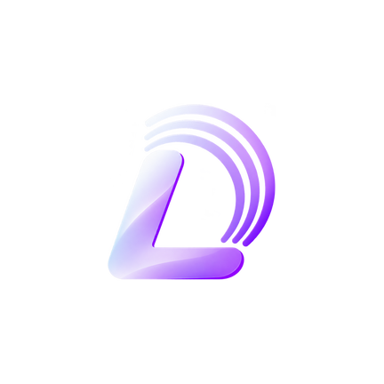
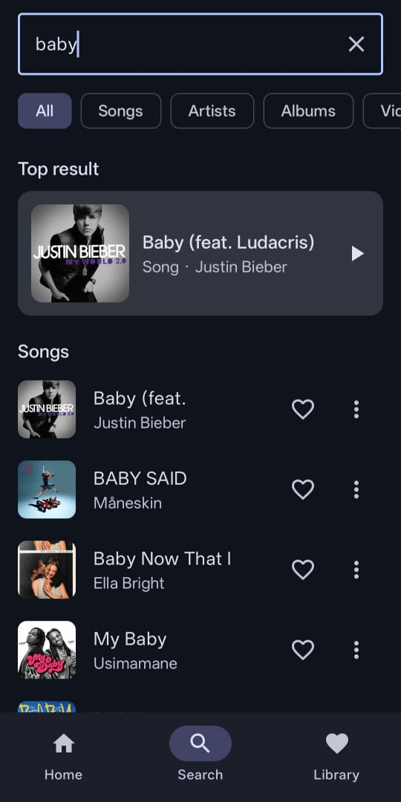
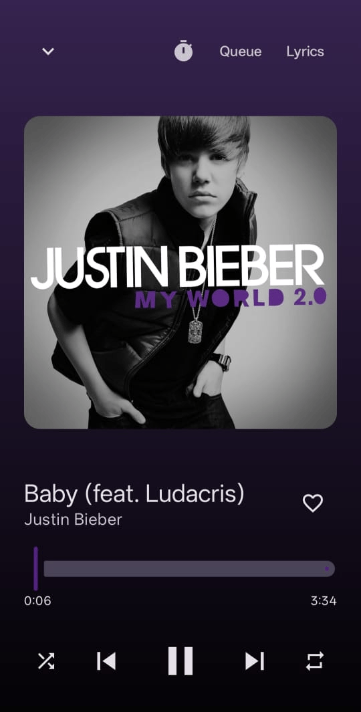
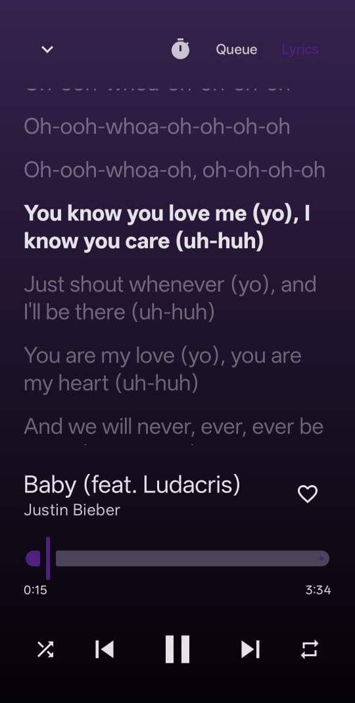

<p align="center">
  
</p>

<h1 align="center">LAbel</h1>

<p align="center"><strong>A music player that takes its colors from the song.</strong></p>
<p align="center">An independent YouTube Music client for Android, built with Kotlin and Jetpack Compose.</p>

<p align="center">
  <a href="https://github.com/aghielaan22/LAbel/releases/latest"></a>
  <a href="https://github.com/aghielaan22/LAbel/releases/tag/v1.0.0"></a>
  
  <a href="LICENSE"></a>
</p>

<p align="center">
  <a href="#features">Features</a> ·
  <a href="#install">Install</a> ·
  <a href="#build-from-source">Build from source</a> ·
  <a href="#privacy">Privacy</a> ·
  <a href="#report-an-issue">Report an issue</a>
</p>

## At a glance

| Home | Search | Now Playing | Lyrics |
| :---: | :---: | :---: | :---: |
|  |  |  |  |

*Screenshots from an earlier build.*

## Features

| | What you can do |
| --- | --- |
| **Discover** | Search songs, artists, albums, and videos. Revisit recent searches and browse recommendations on Home. |
| **Listen** | Keep music playing in the background, manage and reorder your queue, set a sleep timer, or tune the sound with the equalizer. |
| **Make it yours** | Choose cover, vinyl, or sleeve artwork. Try album-art colors across the app, liquid glass, and a glow that reacts to the music in Now Playing. |
| **Follow the lyrics** | Read timed lines, tap a line to jump to it, or show a Latin-letter reading for supported lyrics. Share a song, selected lyrics, or a Year in Review as an image. |
| **Build your library** | Save likes and playlists, import YouTube or YouTube Music playlist links, and rediscover music in **Forgotten favorites** or **Heavy rotation**. |
| **Play from anywhere on your phone** | Use the notification, lock-screen controls, home-screen widget, or Quick Settings tile. Fully cached tracks can play again offline. |
| **Choose a lighter experience** | Turn on **Battery Saver** to simplify visuals and pause next-track prefetching. |
| **Listen together** | Host or join a synced listening session in Studio using a configured relay server. |

## Install

1. Open [**GitHub Releases**](https://github.com/aghielaan22/LAbel/releases/latest) and download the APK under **Assets**. For v1.0.0, the file is `LAbel-1.0.0.apk`.
2. Open the APK on your phone. If Android prompts you, allow the browser or file manager you used to install apps from that source.
3. Open LAbel and search for a song.

**Requirements.** Android 8.0 or newer. Search and uncached streaming need an internet connection. Romanization requires Android 10 or newer and covers Hangul, Greek, Cyrillic, and Japanese kana on lines without kanji. Hardware-accelerated glass refraction is available on supported Android 13 and newer devices.

**Updating.** Install the new APK over an earlier build signed with the same key. If you’re switching from a differently signed build, export your library from **Settings → Backup → Export library** before uninstalling it. The export covers likes, playlists, and selected settings. Install the release APK, then choose **Restore from backup**.

## Build from source

Open the project in [Android Studio](https://developer.android.com/studio) with Android SDK Platform 37 installed. The CI workflow uses JDK 21. Gradle is supplied by the wrapper.

```bash
git clone https://github.com/aghielaan22/LAbel.git
cd LAbel
bash ./gradlew :app:fastCheck
```

On Windows, run `.\gradlew.bat :app:fastCheck` from the project root. The task builds the debug APK and runs the local unit tests. To run the app, select a phone or emulator and click **Run**. To build a distributable APK, use **Build → Generate Signed Bundle / APK** with your signing key.

<details>
<summary>Project layout</summary>

| Area | Responsibility |
| --- | --- |
| `PlaybackService` and `PlayerController` | Media3 playback, media session, and queue control |
| `MusicRepository` and `LyricsRepository` | Catalog lookup, stream resolution, and lyric retrieval |
| `PlaybackAudioCache` | On-device audio cache |
| Library, playlist, and history repositories | Likes, playlists, and listening activity |
| `StudioController` | Session state and synchronization through a configured relay |

</details>

## Privacy

LAbel stores your library and listening history on your device. The app contacts these services when their features are used.

| Service | What it’s used for |
| --- | --- |
| YouTube and its image servers | Catalog searches, stream requests, and cover art |
| LRCLIB | Lyrics lookup using the track title and artist |
| GitHub | Release checks, configurable in Settings |
| Your Studio relay | Room membership and playback synchronization |
| ListenBrainz | Optional scrobbling when you connect an account |

Crash reports are saved locally. Review a report before sharing it publicly.

## Report an issue

Open a [GitHub issue](https://github.com/aghielaan22/LAbel/issues) with your LAbel version, phone model, Android version, and the steps that reproduce the problem. For search or playback problems, say which screen or operation failed.

LAbel is an independent project. YouTube, YouTube Music, and Google are trademarks of their respective owners. Catalog access may be affected by changes to YouTube.

## Credits and license

- [NewPipeExtractor](https://github.com/TeamNewPipe/NewPipeExtractor) for catalog and stream extraction.
- [LRCLIB](https://lrclib.net/) for community-maintained lyrics.
- [Jetpack Compose](https://developer.android.com/develop/ui/compose), [Media3](https://developer.android.com/media/media3), [Coil](https://coil-kt.github.io/coil/), [OkHttp](https://square.github.io/okhttp/), [Palette](https://developer.android.com/jetpack/androidx/releases/palette), and [Haze](https://github.com/chrisbanes/haze).
- [BitChord](https://github.com/kushagrasinghx/BitChord) by kushagrasinghx for early design inspiration.

LAbel is distributed under the [GNU General Public License v3.0](LICENSE).
